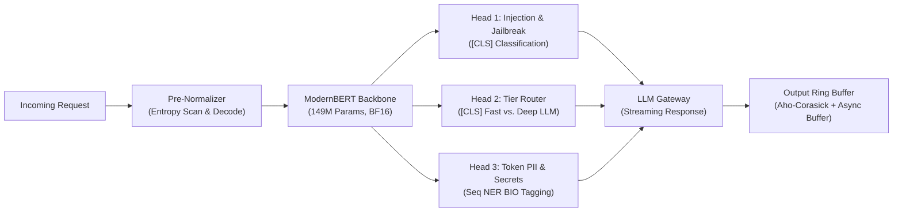

# GlaDos (Zero-Latency Prompt Injection & Exfiltration Firewall)

> **Sub-10ms Non-Autoregressive Inspection Proxy & Intelligence-Tier Router for LLM Gateways**

| Target SLA | Backbone Model | Architecture | Target Footprint |
| :---: | :---: | :---: | :---: |
| **< 10.0 ms** | ModernBERT (149M params) | 3 Parallel Linear Heads | ~5.2 GB VRAM (BF16) |

---

## What is GlaDos?

**GlaDos** is a high-performance, non-autoregressive security firewall and intelligent compute router designed to sit directly in front of LLM inference gateways and RAG pipelines.

Instead of generating verification tokens sequentially, GlaDos processes input tokens simultaneously in a single parallel matrix pass using an encoder backbone. Within **3.5ms to 4.5ms**, GlaDos evaluates three critical tasks concurrently:

1. **Prompt Injection & Jailbreak Detection (`Head 1`)**: Flags direct attacks, multi-turn RAG indirect prompt injections, and obfuscated jailbreak attempts.
2. **Compute-Tier Intelligence Routing (`Head 2`)**: Classifies prompt complexity into discrete tiers (e.g., trivial/fast queries vs. deep reasoning tasks) to optimize downstream model utilization and API spend.
3. **Token-Level PII & Secret Redaction (`Head 3`)**: Identifies sensitive tokens (API keys, credentials, emails, identity numbers) via subword sequence NER tagging (`BIO` format).

In addition to input inspection, GlaDos incorporates a deterministic pre-tokenizer normalizer (decoding Base64, Hex, and Rot13 attacks before tokenization) and an output ring buffer with dual-tier scanning to safeguard streaming SSE responses without stalling token-per-second (TPS) throughput.

---

## Why GlaDos?

### 1. The Autoregressive Guardrail Bottleneck
Current industry guardrails rely heavily on **"LLM-as-a-Judge"** systems (e.g., Llama-Guard). Because autoregressive models generate tokens one-by-one:
- They add **300ms to 800ms of latency** to every user request.
- They double compute requirements and API costs.
- They create an unacceptable user experience bottleneck, particularly in real-time interactive agents and voice pipelines.

### 2. Emerging Production Attack Vectors
Modern production LLM applications face threats that static keyword filters and simple heuristics miss:
- **Encoded Jailbreaks**: Adversaries disguise attacks in Base64, Hex, or simple ciphers. Subword tokenizers fragment these into arbitrary tokens, blinding standard classifiers unless normalized before tokenization.
- **Multi-Turn Indirect RAG Injections**: Malicious instructions embedded deep inside retrieved documents or third-party tool outputs that attempt to hijack system instructions.
- **Streaming PII Exfiltration**: Sensitive credentials or personal data leaking token-by-token over live Server-Sent Events (SSE) connections.

### 3. Core Architectural Insight: Single Backbone Multi-Tasking
Running separate independent models for injection detection, PII sanitization, and query routing multiplies latency linearly ($>12\text{ms}$). 

By attaching three lightweight linear classification heads to the exact same `last_hidden_state` tensor of a single **ModernBERT** forward pass, all three inspection tasks execute in roughly **0.35ms of extra matrix multiplication**. This delivers comprehensive security verification, PII redaction, and intelligent routing well within a strict **10ms end-to-end proxy SLA**.

---

## Pipeline Overview

